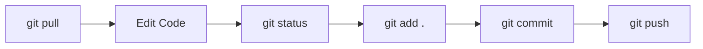

# Complete Professional Git & GitHub Workflow Guide

A step-by-step, structural guide to initializing, managing, branching, pushing, and pulling repositories cleanly and safely.

---

## Table of Contents
1. [Prerequisites & Global Configuration](#1-prerequisites--global-configuration)
2. [Step 1: Protect Sensitive Files (.gitignore)](#step-1-protect-sensitive-files-gitignore)
3. [Step 2: Creating the Remote GitHub Repository](#step-2-creating-the-remote-github-repository)
4. [Step 3: Initializing and Connecting Your Local Repository](#step-3-initializing-and-connecting-your-local-repository)
5. [Step 4: Making Clean, Structured Commits](#step-4-making-clean-structured-commits)
6. [Step 5: The Daily Workflow (Pushing & Pulling)](#step-5-the-daily-workflow-pushing--pulling)
7. [Step 6: Team/Feature Branch Workflow (Best Practice)](#step-6-teamfeature-branch-workflow-best-practice)
8. [Step 7: Resolving Merge Conflicts](#step-7-resolving-merge-conflicts)
9. [Crucial Git Golden Rules (Do's & Don'ts)](#crucial-git-golden-rules-dos--donts)

---

## 1. Prerequisites & Global Configuration

Before running any repository commands, make sure Git knows who you are. This metadata attaches to every commit you push to GitHub.

Run these in PowerShell or your terminal (only needed once per computer):

```powershell
# Set your name (displays on GitHub commits)
git config --global user.name "Your GitHub Username"

# Set your email (must match your GitHub registered email)
git config --global user.email "your_email@example.com"

# Set default initial branch name to main
git config --global init.defaultBranch main
```

To verify your configuration:
```powershell
git config --list
```

---

## Step 1: Protect Sensitive Files (`.gitignore`)

> [!CAUTION]
> **Never commit credentials, API keys, or large build dependencies.**
> Before staging any files, ensure your repository has a `.gitignore` file at the root.

Create or verify a `.gitignore` file with at least:

```gitignore
# Dependencies
node_modules/
__pycache__/
*.pyc
venv/
.env/

# Environment Variables & Secrets (CRITICAL)
.env
.env.local
.env.*.local
*.key
*.pem

# Build artifacts and logs
dist/
build/
*.log
npm-debug.log*

# OS and Editor metadata
.DS_Store
Thumbs.db
.vscode/
.idea/
```

Check what Git sees before continuing:
```powershell
git status
```
*Ensure `.env` and `node_modules/` do NOT appear in untracked files.*

---

## Step 2: Creating the Remote GitHub Repository

1. Open your browser and go to [GitHub](https://github.com).
2. Log in and click the **`+`** icon in the top-right corner &rarr; select **New repository** (or visit [github.com/new](https://github.com/new)).
3. Fill in the details:
   - **Repository name**: e.g., `CSI_Club_Operations_Platform_Spec`
   - **Description**: Short description of the project.
   - **Visibility**: Choose **Public** or **Private**.
   - **Initialize this repository with**: **Leave unchecked** (do *not* check README, .gitignore, or license if you already have local files).
4. Click **Create repository**.
5. Keep the page open — GitHub will display the repository URL:
   - HTTPS: `https://github.com/<your-username>/<your-repo-name>.git`

---

## Step 3: Initializing and Connecting Your Local Repository

Open your terminal in your project's root folder (`r:\VSCODE\CSI_Club_Operations_Platform_Spec`):

```powershell
# 1. Initialize git in the folder
git init

# 2. Verify current status
git status

# 3. Rename default branch to main (standard convention)
git branch -M main

# 4. Link your local project to your GitHub repository
# Replace <URL> with your actual GitHub repository URL
git remote add origin https://github.com/<your-username>/<your-repo-name>.git

# 5. Verify the remote link
git remote -v
```

---

## Step 4: Making Clean, Structured Commits

### 4.1 Conventional Commit Messages
Write commit messages using the **Conventional Commits** standard:
- `feat: ...` for a new feature
- `fix: ...` for a bug fix
- `docs: ...` for documentation updates
- `style: ...` for formatting, CSS tweaks, no logic changes
- `refactor: ...` for code restructuring without feature changes
- `chore: ...` for dependencies, config files, build tasks

*Example: `feat: implement student QR scanner for event check-in`*

### 4.2 Your First Commit
```powershell
# 1. Check which files are ready to stage
git status

# 2. Stage all files (respecting .gitignore)
git add .

# Or stage specific files intentionally:
# git add src/ public/ README.md

# 3. Check staged files (green items are staged)
git status

# 4. Commit with a meaningful message
git commit -m "feat: initial commit for CSI club operations platform"

# 5. Push to GitHub and establish tracking (-u links local 'main' to remote 'main')
git push -u origin main
```

---

## Step 5: The Daily Workflow (Pushing & Pulling)

Whenever you work on code, follow this sequence:



### 1. Always Pull Before You Start
If working in a team or across multiple devices, always pull the latest changes before starting:
```powershell
git pull origin main
```

### 2. Stage Your Work
```powershell
# See modified and untracked files
git status

# Stage modified files
git add <filename>       # specific file
git add .                # all tracked & untracked changes
```

### 3. Commit Locally
```powershell
git commit -m "fix: resolve session expiration redirect in auth listener"
```

### 4. Push to GitHub
```powershell
# Once -u was set initially, a simple push works:
git push
```

---

## Step 6: Team/Feature Branch Workflow (Best Practice)

Never push directly to `main` when adding complex features or working with teammates. Use **Feature Branches**:

### 1. Create and Switch to a New Branch
```powershell
# Format: feature/<feature-name> or fix/<issue-name>
git checkout -b feature/attendance-analytics
```

### 2. Work, Stage, and Commit on Your Branch
```powershell
git add .
git commit -m "feat: add real-time attendance analytics dashboard"
```

### 3. Push the Feature Branch to GitHub
```powershell
git push -u origin feature/attendance-analytics
```

### 4. Create a Pull Request (PR) on GitHub
1. Navigate to your repository on GitHub.
2. You will see a banner: **`feature/attendance-analytics had recent pushes`**.
3. Click **Compare & pull request**.
4. Add description and submit PR.
5. Review the diff, run checks, and click **Merge pull request**.

### 5. Sync Your Local `main` and Clean Up
```powershell
# Switch back to main
git checkout main

# Pull the merged changes
git pull origin main

# Delete the local feature branch (optional)
git branch -d feature/attendance-analytics
```

---

## Step 7: Resolving Merge Conflicts

If GitHub or Git warns that a push was rejected because remote has newer changes:

```powershell
# 1. Fetch and merge remote changes
git pull origin main

# 2. If conflicts occur, run:
git status
```

Files with conflicts will contain markers:
```text
<<<<<<< HEAD (Your local changes)
const apiEndpoint = "/api/v2/events";
=======
const apiEndpoint = "/api/v1/events";
>>>>>>> origin/main (Incoming remote changes)
```

1. Open the file in VS Code and choose:
   - **Accept Current Change**
   - **Accept Incoming Change**
   - **Accept Both Changes** or manually edit the code.
2. Delete the markers (`<<<<<<<`, `=======`, `>>>>>>>`).
3. Save the file.
4. Stage and commit the resolution:
   ```powershell
   git add .
   git commit -m "chore: resolve merge conflict in event service"
   git push
   ```

---

## Crucial Git Golden Rules (Do's & Don'ts)

| Action | Do | Don't |
| :--- | :--- | :--- |
| **Secrets** | Keep `.env` in `.gitignore` and supply `.env.example`. | **NEVER** push live DB passwords, service keys, or tokens. |
| **Commit Size** | Make small, atomic commits addressing one specific change. | Don't bundle 2 weeks of changes into `git commit -m "fixes"`. |
| **Branch Safety** | Use feature branches and PRs for substantial updates. | Don't push experimental untested code directly to `main`. |
| **Pulling** | Run `git pull` before starting a coding session. | Don't wait until the end of the day to sync with team code. |
| **Force Pushing** | Only use `--force-with-lease` on your private branches if necessary. | **NEVER** run `git push -f` or `--force` on `main`. |

---

## Quick Reference Cheatsheet

```powershell
# Inspect
git status                       # Current staged/unstaged changes
git log --oneline -n 5           # View last 5 commits cleanly
git diff                         # See uncommitted line-by-line changes

# Branches
git branch                       # List local branches
git checkout -b <branch-name>    # Create and switch to new branch
git checkout <branch-name>       # Switch between branches

# Undo / Discard (Use carefully)
git restore <file>               # Discard uncommitted changes in working file
git restore --staged <file>      # Unstage a file from staging area
git reset --soft HEAD~1          # Undo last commit, keep changes staged
```
